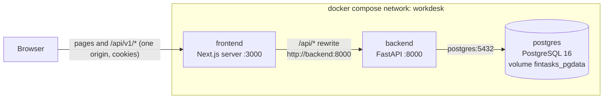

# Finbase Workdesk

A project and task management platform for small teams, built for the Finbase Full Stack Engineer
assignment (`req_docs/Full_Stack_Engineer_Assignment.pdf`). It was developed under the working
names "FinTasks" and "TaskFlow". The backend, the database and the tokens still use `fintasks`
internally, because renaming them would sign every user out and break existing local databases.

- **Full technical write-up:** [`docs/ASSIGNMENT_SUBMISSION.md`](docs/ASSIGNMENT_SUBMISSION.md).
- **Requirement-by-requirement check:** [`docs/assignment-compliance-matrix.md`](docs/assignment-compliance-matrix.md).

## Run everything with one command

```bash
cp .env.example .env      # then set POSTGRES_PASSWORD and JWT_SECRET_KEY (see below)
docker compose up --build # or in the background: docker compose up --build -d
```

| What | URL |
|---|---|
| Application (frontend) | http://localhost:3000 |
| Backend API | http://localhost:8000/api/v1 |
| Swagger UI | http://localhost:8000/docs |
| OpenAPI schema | http://localhost:8000/openapi.json (also exported as `docs/openapi.json`) |

The two values to set in `.env`:

```bash
openssl rand -hex 16      # POSTGRES_PASSWORD (hex keeps it safe inside the database URL)
openssl rand -base64 48   # JWT_SECRET_KEY (at least 32 characters)
```

Everyday commands:

```bash
docker compose ps                 # the three containers and their health
docker compose logs -f            # follow all logs
docker compose logs -f backend    # follow one service
docker compose down               # stop and remove the containers; the database is KEPT
docker compose down -v            # ALSO deletes the database volume: all data is lost for good
```

Ports 3000, 8000 and 5433 must be free on the host. All of them can be changed in `.env`. If you
change `FRONTEND_PORT`, set `ALLOWED_ORIGINS` to the new URL as well.

How this was verified: the stack was built and run with Podman 6.1.4 and podman-compose 1.6.0,
using `podman compose up --build`. Docker itself was not installed on the development machine.
The compose file uses only standard Compose features. Details are in
[Docker and deployment](docs/ASSIGNMENT_SUBMISSION.md#9-docker-and-deployment).

## Problem and features

Small teams need one place to plan work, decide who does what, and see progress, without everyone
being able to change everything. Finbase Workdesk provides:

- **Accounts.** Register, sign in and sign out. JWT access and refresh tokens are kept in HttpOnly
  cookies, the refresh token rotates on every use, and replaying an old refresh token revokes the
  whole token family. Passwords are hashed with Argon2id.
- **Projects.** Create, edit, archive and delete projects. A project is visible only to its
  members.
- **Members.** The owner adds registered users by email and removes them. Removing a member cuts
  their access at once and unassigns their tasks.
- **Tasks.** Title, description, priority, due date, an assignee chosen from the members, and
  status `todo -> in_progress -> completed`. Tasks can be searched, filtered (status, priority,
  assignee, due date range, overdue), sorted and paginated.
- **Dashboard.** Total and active projects, total, completed, pending and overdue tasks, tasks
  assigned to you, a completion percentage, your open tasks, upcoming due dates and recent
  activity.
- **Activity timeline.** Every change is written to an audit log in the same transaction, and
  shown per project and across your projects.
- **Policy-based access control.** Every permission is decided by a central engine with JSON
  policies. There are **no roles**.

## Technology

| Layer | Choice |
|---|---|
| Backend | Python 3.12, FastAPI, SQLAlchemy 2.0 (sync), Alembic, Pydantic v2, PyJWT, argon2-cffi |
| Database | PostgreSQL 16 (`pg_trgm` for text search) |
| Frontend | Next.js 16 (App Router), React 19, TypeScript (strict), Tailwind CSS 4, shadcn/ui, TanStack Query, React Hook Form, Zod |
| Containers | Docker / Podman, Docker Compose (3 services) |
| Tests | pytest on real PostgreSQL; Vitest + Testing Library; end-to-end scripts against the running stack |
| CI | GitHub Actions workflow (`.github/workflows/ci.yml`). Its jobs were run locally command by command, but the workflow has not run on GitHub yet |

## Architecture



- **Browser path.** The browser only talks to the frontend origin. The Next.js server forwards
  `/api/*` to the backend over the internal network. That keeps cookies first-party, and in normal
  use the browser never needs CORS.
- **Backend layers.** Routers handle HTTP only and call one service method each. Services hold
  the business rules and transactions. Repositories hold queries only. Every service calls the
  authorization layer (`backend/app/authorization/`) before it reads or changes protected data.
- **Errors.** One handler module turns domain exceptions into a single error envelope:
  `{"error": {"code", "message", "details", "request_id"}}`.
- **Frontend.** One API client handles cookies, the CSRF header, errors, and a single shared
  refresh-and-retry on a 401. TanStack Query caches data and refreshes it after changes. Forms use
  the same limits as the backend. Every list and card has loading, empty and error states.

## Authorization (PBAC): the seven required policies

Rules live in `backend/app/authorization/policies.json` and are validated when the application
starts. Conditions are a fixed registry of Python functions, so the JSON can combine them but
never run code. An unknown action, a missing policy or an evaluation error always means **deny**.

| # | Assignment rule | Policy id | Result when denied |
|---|---|---|---|
| 1 | Only members can view a project | `project-view` | 404 (existence is not revealed) |
| 2 | Only the owner updates project details | `project-update` | 403 |
| 3 | Only the owner deletes a project | `project-delete` | 403 |
| 4 | Only members create tasks | `task-create` | 404 for non-members |
| 5 | A task can be updated by its creator or its assignee | `task-update` | 403 |
| 6 | A task can be deleted only by the project owner, and only while it is Todo | `task-delete` | 403 |
| 7 | A task can be completed only with an assignee and all required fields (title, description, priority, due date) | `task-complete` | 403 |

There are two more policies: `project-create` (any signed-in user) and `project-member-manage`
(owner only). The engine design is explained in
[`docs/ASSIGNMENT_SUBMISSION.md`](docs/ASSIGNMENT_SUBMISSION.md#6-policy-based-access-control) and
[`docs/authorization-design.md`](docs/authorization-design.md).

## API overview

There are 24 REST endpoints under `/api/v1`: `auth/*`, `projects`, `projects/{id}/members`,
`projects/{id}/tasks`, `tasks/{id}`, `tasks/{id}/status`, `me/tasks` (my assigned tasks across
projects), `dashboard/*` and `projects/{id}/activity`. Responses use `{data}`, `{data, meta}` for
paged lists, or `{error}`.
Changing requests need the `X-CSRF-Token` header that matches the `csrf_token` cookie.

| Resource | Where |
|---|---|
| Interactive docs | Swagger at `/docs` |
| Full contract with real examples | [`docs/api-contract.md`](docs/api-contract.md) |
| Postman collection | [`docs/postman/fintasks.postman_collection.json`](docs/postman/fintasks.postman_collection.json) |

## Database

Six tables: `users`, `projects`, `project_members`, `tasks`, `refresh_tokens` and
`activity_logs`. They use UUID keys and `timestamptz`. `CHECK` constraints cover status, priority,
blank names and completion state. A composite foreign key makes it impossible to assign a task to
someone who is not a member of the project.

Migrations are in `backend/alembic/versions/`. In Docker, the backend applies them on start
(`alembic upgrade head`, under a PostgreSQL advisory lock). Without Docker, run them by hand:

```bash
cd backend && alembic upgrade head
```

The ER diagram is in [`docs/ASSIGNMENT_SUBMISSION.md`](docs/ASSIGNMENT_SUBMISSION.md#7-database-design)
and the details in [`docs/database-design.md`](docs/database-design.md).

## Environment variables

Docker reads the root `.env`, which you create from [`.env.example`](.env.example).

| Variable | Used by | Default | Notes |
|---|---|---|---|
| `POSTGRES_USER`, `POSTGRES_PASSWORD`, `POSTGRES_DB` | postgres, backend | `fintasks`, required, `fintasks` | The backend builds `DATABASE_URL` from these, pointing at `postgres:5432` |
| `POSTGRES_PORT` | host only | `5433` | Bound to `127.0.0.1`, for psql and the test suite |
| `JWT_SECRET_KEY` | backend | required | At least 32 characters; never given to the frontend |
| `JWT_ISSUER`, `ACCESS_TOKEN_EXPIRE_MINUTES`, `REFRESH_TOKEN_EXPIRE_DAYS` | backend | `fintasks-api`, `15`, `7` | The algorithm is fixed to HS256 in code |
| `ENVIRONMENT`, `LOG_LEVEL` | backend | `development`, `INFO` | `production` requires `COOKIE_SECURE=true`, which needs HTTPS |
| `COOKIE_SECURE`, `COOKIE_SAMESITE` | backend | `false`, `lax` | `false` is right for plain `http://localhost` |
| `ALLOWED_ORIGINS` | backend | `http://localhost:3000` | The URL people open; used by CORS and the CSRF Origin check |
| `BACKEND_PORT`, `FRONTEND_PORT` | host | `8000`, `3000` | |
| `NEXT_PUBLIC_API_BASE_URL` | frontend (build) | empty | Empty means the browser uses the frontend origin (recommended) |
| `NEXT_PUBLIC_APP_NAME` | frontend (build) | `Finbase Workdesk` | |

To run without Docker, use `backend/.env.example` and `frontend/.env.example`.

## Local development without Docker

```bash
cp .env.example .env && docker compose up -d postgres     # only the database
cd backend && uv venv --python 3.12 .venv && source .venv/bin/activate
uv pip install -r requirements-dev.txt
cp .env.example .env              # DATABASE_URL and TEST_DATABASE_URL on localhost:5433, JWT_SECRET_KEY
alembic upgrade head && uvicorn app.main:app --reload     # http://localhost:8000
cd ../frontend && pnpm install && pnpm dev                # http://localhost:3000
```

Step-by-step notes are in `backend/README.md` and `frontend/README.md`.

## Testing

Results from 16 November 2026:

| Suite | Command | Result |
|---|---|---|
| Backend unit and API tests (real PostgreSQL) | `cd backend && pytest` | **990 passed**, 99% line coverage |
| Backend static checks | `ruff check . && ruff format --check . && mypy && alembic check` | clean |
| Frontend unit and component tests | `cd frontend && pnpm test` | **381 passed** |
| Frontend static checks and build | `pnpm lint && pnpm typecheck && pnpm format:check && pnpm build` | clean |
| Frontend end-to-end, real API through the Docker frontend proxy | `LIVE_API_URL=http://localhost:3000 LIVE_ORIGIN=http://localhost:3000 pnpm test:live` | **76 passed** |
| Stack smoke test (3 users, all 7 policies) | `python3 scripts/smoke_test.py` | **38 of 38** |
| Real browser (headless Chrome, 1440px and 390px) | `node scripts/browser-check.mjs` | **24 of 24** |

The backend tests need `TEST_DATABASE_URL`, pointing at a database whose name ends in `_test`. The
Docker database creates `fintasks_test` automatically on first start. The end-to-end scripts
create throwaway users (`smoke-…`, `browser-…`, `authlive-…`, and so on) in the database they run
against.

## Folder structure

```
FinbaseTrack/
├── backend/            FastAPI app (app/), Alembic migrations, tests/, Dockerfile, scripts/migrate.py
├── frontend/           Next.js app (src/), tests/, Dockerfile, reference/ (design screenshots)
├── docs/               submission document, compliance matrix, API contract, OpenAPI, Postman, designs
├── infra/postgres/     database init script (creates the _test database)
├── scripts/            smoke_test.py and browser-check.mjs (run against a running stack)
├── .github/workflows/  CI workflow
├── docker-compose.yml  postgres + backend + frontend
└── .env.example        every variable docker-compose.yml reads
```

## Assumptions

- The project owner is always a member and cannot be removed. There is no ownership transfer.
- Members are added by the email of an already registered user. There are no invitations.
- "Pending" means To do plus In progress. "Overdue" means due before today (UTC) and not
  completed.
- Status moves one step at a time. Completing a task needs an assignee, title, description,
  priority and due date.
- Deleting a project hard-deletes its tasks and memberships. The audit log keeps the history.

## Trade-offs and known limitations

- **Session storage.** Cookies with a CSRF token were chosen over `localStorage` tokens to protect
  against token theft through XSS. The cost is a CSRF header on every change.
- **Synchronous SQLAlchemy.** Simpler to reason about and test, and enough for this load.
- **One origin through a proxy.** Next.js forwards `/api/*`, so the backend address is fixed when
  the frontend image is built (`BACKEND_INTERNAL_URL`).
- **Docker build skips the Next.js type check.** It ran out of memory in a 2 GB container VM.
  Types are still checked by `pnpm typecheck` and in CI.
- **Not built:**
  - a Kanban board with drag and drop (status changes use a dropdown);
  - login rate limiting;
  - cleanup of expired refresh tokens;
  - password reset and email.
- **Session end.** An access token stays valid until it expires (up to 15 minutes) after logout.
- **Colors.** The theme colors were estimated from screenshots of finbasetech.com
  (`frontend/reference/`). The logo mark is original artwork.
