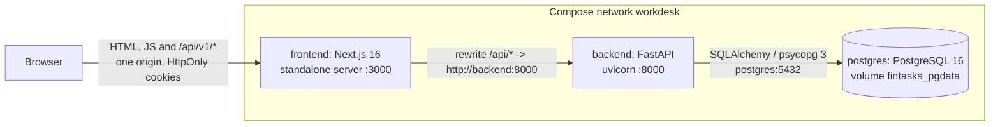
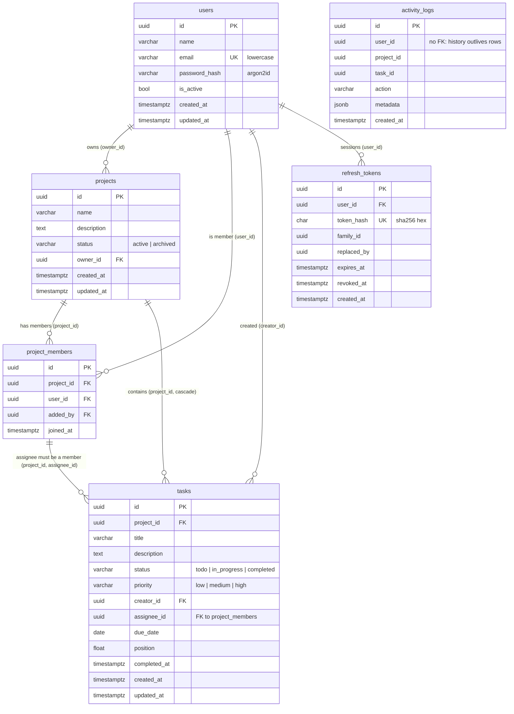

# Finbase Workdesk: Full Stack Engineer assignment submission

- Repository: `github.com/HarshParmarCS/FinbaseTrack`.
- Assignment: `req_docs/Full_Stack_Engineer_Assignment.pdf`.
- Requirement checklist: [`assignment-compliance-matrix.md`](assignment-compliance-matrix.md).
- Every number in this document comes from runs on 16 November 2026, listed in section 10.

## 1. Executive summary

Finbase Workdesk is a project and task management platform in the style of Jira or Trello. It was
built under the working names FinTasks and TaskFlow. Teams create projects, add members, plan and
assign tasks, move them through To do, In progress and Completed, and follow progress on a
dashboard and an activity timeline.

The central engineering problem is **who may do what**. The assignment asks for policy-based
access control (PBAC) and forbids role-based access control (RBAC). Every permission in the
application is decided by one authorization layer that evaluates JSON-defined policies against
current facts from the database. No role exists anywhere in the code or the schema.

Main technologies: a FastAPI backend (Python 3.12, SQLAlchemy 2.0, Alembic), PostgreSQL 16, and a
Next.js 16 frontend (TypeScript, TanStack Query, React Hook Form, Zod). It runs as three
containers with `docker compose up --build`.

## 2. Functional features

| Area | What a user can do |
|---|---|
| **Authentication** | Register (signs you in), sign in, sign out (button at the bottom of the sidebar). Sessions survive reloads. An expired access token is refreshed silently. When the session really ends you return to sign-in with a message |
| **Projects** | Create, rename, describe, archive and delete. Search by name, filter by status, paginate. Only members see a project |
| **Membership** | The owner adds registered users by email and removes them. The owner is always a member. Removing a member revokes access at once and unassigns their tasks in the same transaction |
| **Tasks** | Title, description, priority (low, medium, high), due date, assignee (members only), status. Search title and description, filter by status and priority (several values), assignee or "unassigned", due date range and "overdue". Nine sort orders. Page sizes up to 100 |
| **Dashboard** | Total and active projects, total, completed, pending and overdue tasks, assigned to me, completion percentage. Also my open tasks, upcoming due dates, project progress, task status breakdown and recent activity. Quick "New project" and "New task" actions |
| **Activity log** | Every change writes an audit row in the same transaction. A day-grouped timeline per project and across all of the user's projects |

## 3. System architecture



- **Frontend.** Renders the pages and holds no secrets. The browser sends every API call to the
  frontend origin (`/api/v1/...`), and the Next.js server forwards it to the backend over the
  private network. Cookies therefore stay first-party, and the browser never needs the backend's
  address.
- **Backend.** A stateless JSON API. It authenticates every protected request from cookies, asks
  the authorization layer, applies business rules, and writes the change and its audit row in one
  transaction.
- **PostgreSQL.** The single source of truth, holding all data and the audit log.

One request, step by step:
1. The browser sends `PATCH /api/v1/tasks/{id}` to the frontend.
2. The frontend forwards it to the backend.
3. Middleware assigns a request id and checks the `Origin` header and the `X-CSRF-Token` header
   against the cookie.
4. `get_current_user` verifies the access JWT.
5. The router validates the body and calls `TaskService.update_task`.
6. The service calls `AuthorizationService.require(...)`, which reads fresh facts and evaluates
   the policy. A denial stops the request here with 403 or 404.
7. The service applies the change and the audit row, then commits.
8. The router returns `{data}`.

## 4. Backend design

**Layers** (`backend/app/`), each with one job:

| Layer | Responsibility | Must not |
|---|---|---|
| `routers/` | HTTP only: parse and validate, call one service method, return the envelope | contain business logic or call repositories |
| `services/` | Business rules and transactions; call the authorization layer first | make authorization decisions themselves |
| `repositories/` | Queries only | commit, or decide access |
| `models/` | SQLAlchemy 2.0 typed models (`Mapped[...]`) | |
| `authorization/` | All access decisions | know about HTTP |
| `core/` | Settings, logging, exceptions, middleware (request id, CSRF, security headers, CORS) | |

These rules are enforced by tests, not just by convention:
- `tests/audit/test_guards.py::test_service_method_asks_the_policy_engine_before_touching_data`
  reads the source of every service method and fails if data is touched before `self.authz` is
  called.
- `test_every_non_public_route_depends_on_get_current_user` checks every route.

**SQLAlchemy.** It runs in synchronous mode, in the typed 2.0 style. List queries load creators
and assignees in one query, so there are no N+1 queries. The engine uses `hide_parameters=True`,
so SQL values never reach the logs.

**Migrations.** Alembic, with one migration so far:
`alembic/versions/20261115_0206_4138ca71fcc2_initial_schema.py`. Its hand-written parts cover what
autogenerate cannot express: the `pg_trgm` extension, a circular deferrable foreign key, and
trigram indexes. `alembic check` reports no drift between the models and the database. The
container entrypoint runs `python -m scripts.migrate`, which waits for the database, takes a
PostgreSQL advisory lock and runs `alembic upgrade head`. Two backend containers starting together
therefore never run competing migrations, and nothing is ever dropped or recreated.

**API design.** 24 REST operations under `/api/v1`, with plural nouns and correct verbs:

| Status code | Meaning here |
|---|---|
| 201 | Created |
| 204 | Deleted, or signed out |
| 401 | No valid session |
| 403 | Denied by a policy, or a failed CSRF or Origin check |
| 404 | Missing, or not visible to you |
| 409 | Duplicate (for example, an email that is already registered) |
| 422 | Invalid input or a broken business rule |

- **Response shapes.** One envelope for single items `{data}`, one for paged lists
  `{data, meta: {page, page_size, total, total_pages}}`, and one for errors
  `{error: {code, message, details[], request_id}}`.
- **Input validation.** Pydantic models reject unknown fields and enforce lengths and types.
- **Generated docs.** `docs/api-contract.md` (section 3) and `docs/openapi.json` are generated from
  the running application. A test fails if either drifts from the code.

## 5. Authentication and security

**Tokens.** Both are JWTs signed with HS256. The algorithm is fixed in code, and the key comes only
from `JWT_SECRET_KEY`:
- **Access token:** valid 15 minutes, audience `fintasks:access`.
- **Refresh token:** valid 7 days, audience `fintasks:refresh`.

Both carry `sub`, `iat`, `exp`, `iss`, `aud` and `jti`. Validation checks the signature, expiry,
issuer, audience and token type. Tests reject the `none` algorithm and algorithm substitution.

**Cookies.** Tokens are never visible to JavaScript:

| Cookie | Readable by JavaScript | Path | Purpose |
|---|---|---|---|
| `access_token` | No (HttpOnly) | `/` | Authenticates API calls |
| `refresh_token` | No (HttpOnly) | `/api/v1/auth` only | Gets a new access token |
| `csrf_token` | Yes | `/` | Echoed in the `X-CSRF-Token` header |

All three use `SameSite=Lax`. The `Secure` flag is configurable and required in production.

**Refresh rotation.** Only a SHA-256 hash of each refresh token is stored. Every refresh revokes
the old token and issues a new pair in the same family. Presenting a token that was already
rotated is treated as theft: the whole family is revoked, and the event is written to the audit
log.

**Passwords.** Hashed with Argon2id (argon2-cffi), with a per-hash salt. Old hashes are re-hashed
when the parameters change. A wrong password and an unknown email return the same 401 message.

**CSRF and CORS.** A changing request with session cookies needs `X-CSRF-Token` equal to the
cookie (double submit), and an `Origin` that is in `ALLOWED_ORIGINS` or is the API's own origin.
CORS allows only `ALLOWED_ORIGINS`, never `*`, with credentials.

**Protected endpoints.** Every route except health, register, login, refresh and logout depends on
`get_current_user`. A test enumerates all routes and checks that.

## 6. Policy-based access control

**Why PBAC.** The assignment's rules depend on the relationship between a user and a specific
resource (member of this project, creator or assignee of this task) and on the resource's state
(a task's status and whether its fields are filled in). Roles cannot express "the assignee of this
task" or "only while it is Todo". Policies over attributes can, and they keep every rule in one
place.

**Components** (`backend/app/authorization/`):

| Role | File | What it does |
|---|---|---|
| PEP (enforcement) | `service.py` (`AuthorizationService.require`) | Called by services before any protected read or change. Turns a denial into 404 (not visible) or 403 (visible but not allowed) |
| PDP (decision) | `engine.py` (`PolicyEngine`) | Evaluates the policies for an action against a context and returns a `Decision` |
| PIP (information) | `information.py` | Reads current facts from PostgreSQL for each decision: membership, ownership, task creator, assignee, status and fields. Facts are never cached between requests, so a removed member is denied immediately |
| PAP (administration) | `policies.json` + `policy_loader.py` + `registry.py` | Policies are data in JSON, validated strictly at startup. An invalid file stops the application |
| Conditions | `conditions.py` | A fixed registry of pure functions (`is_project_member`, `is_project_owner`, `is_task_creator`, `is_task_assignee`, `task_status_is`, `task_has_assignee`, `task_required_fields_complete`). JSON can combine them with `all` and `any`, but can never define code |

**Evaluation flow.**
1. A service calls `require(user, "task.delete", task_id=...)`.
2. The PIP builds an `AuthorizationContext` from fresh database facts.
3. The engine looks up the policies registered for the action.
4. The engine evaluates them, failing closed at every step:
   - an inactive user is denied;
   - an unknown action is denied;
   - an action with no policy is denied;
   - an explicit deny policy beats any allow;
   - an exception during evaluation is denied and logged;
   - if no allow policy matches, the result is **deny by default**.
5. The PEP raises a domain error, which the central handler turns into the error envelope. The
   envelope includes the `policy_id` that refused the request.

**The seven required policies**, as written in `policies.json`:

| # | Assignment rule | Policy | Conditions |
|---|---|---|---|
| 1 | View only projects you are a member of | `project-view` | `is_project_member` |
| 2 | Only the owner updates a project | `project-update` | `is_project_owner` |
| 3 | Only the owner deletes a project | `project-delete` | `is_project_owner` |
| 4 | Only members create tasks | `task-create` | `is_project_member` |
| 5 | Creator or assignee updates a task | `task-update` | `is_project_member` AND (`is_task_creator` OR `is_task_assignee`) |
| 6 | Delete only when Todo and requested by the owner | `task-delete` | `is_project_owner` AND `task_status_is: todo` |
| 7 | Complete only with an assignee and all required fields | `task-complete` | `is_project_member` AND `task_has_assignee` AND `task_required_fields_complete: [title, description, priority, due_date, assignee]` |

There are two additional policies: `project-create` (any authenticated user) and
`project-member-manage` (owner only).

Some details of how the rules are applied:
- **Visibility is not revealed.** Non-members get 404, never 403, so they cannot tell that a
  project exists.
- **Completion is checked on the result.** Rule 7 is evaluated against the state the task would
  have after the change. Completing an incomplete task is refused, and so is an edit that would
  make an already completed task incomplete.
- **Hiding is not the boundary.** The frontend shows only the actions the API lists in
  `allowed_actions`, but the backend checks every request regardless.

**Configurable policies (bonus).** Rules can be changed in `policies.json` without touching code: who may update projects, which
status a task must have to be deleted, which fields completion requires, or adding an explicit
deny. The loader validates every
key, condition name and parameter. `tests/audit/test_policy_configurability.py` checks two things:
- an edited policy file changes the application's behavior;
- an invalid one prevents startup.

**Data scoping.** List and aggregate endpoints (the project list, dashboard totals, the activity
feed, the My Tasks list) filter by membership inside the query. This is documented in
`docs/authorization-design.md` as data scoping, not as policy decisions.

## 7. Database design



The database enforces these rules itself:
- **Membership.** `UNIQUE (project_id, user_id)` on `project_members`.
- **Owner is a member.** A deferrable composite foreign key from `projects (id, owner_id)` to
  `project_members` guarantees it.
- **Assignee is a member.** The composite foreign key `tasks (project_id, assignee_id)` to
  `project_members` makes it impossible to assign a non-member, and blocks removing a member who
  still has tasks until they are unassigned. The service does that unassignment in the same
  transaction.
- **Valid values.** `CHECK` constraints on status, priority, non-blank names and titles, lowercase
  email, `completed_at` set exactly when the status is completed, and the token hash length.
- **Deletes.** Deleting a project cascades to its tasks and memberships. Activity rows deliberately
  have no foreign keys, so the audit history survives deletes.
- **Indexes for the real queries.** Task lists by project, status and position, by creation time
  and by due date. Trigram indexes support text search.

The schema is normalized. Names and emails live only in `users`, and membership is its own table.
Counts are computed in queries, not stored.

## 8. Frontend design

**Next.js App Router.** The route groups are:
- `(auth)`: sign-in and register, in a split brand layout;
- `(app)`: dashboard, projects, project details, tasks, task details, activity, settings and
  My Tasks, behind an `AuthGate`;
- a public `/diagnostics` page.

`src/proxy.ts` redirects requests without a session cookie to `/login`. That redirect is a
convenience, not a security boundary.

**Structure.**
- `src/features/<area>/` holds each area's API functions, query keys, hooks and components.
- `src/components/ui` holds the shadcn/ui primitives.
- `src/components/shared` holds the building blocks: `PageHeader`, `EmptyState`, `StatCard`,
  `PillTabs`, `PasswordInput`, `ConfirmDialog` and others.
- `src/lib/api` holds the single API client.

**API integration.** `src/lib/api/client.ts` is the only code that calls `fetch`. It:
- sends cookies;
- adds `X-CSRF-Token` to changing requests;
- parses the envelopes into typed results or an `ApiError`;
- on a 401, refreshes once and retries once, with concurrent 401s sharing one refresh and no
  loop.

When a refresh fails, the session ends cleanly. Types in `src/types/api.ts` mirror the contract.

**Forms.** React Hook Form with Zod schemas that use the backend's limits. A server 422 is placed
on the matching field, and a 403 shows "You do not have permission to do this." followed by the
backend's reason. Submit buttons are disabled while saving.

**Loading, empty and error states.**
- Each card loads on its own, with a skeleton, an empty state and an error with retry.
- A thin progress bar runs under the top bar while any request is in flight.
- Route error boundaries never show error details.
- Toasts confirm successful changes.
- Destructive actions ask for confirmation first.

**Design system.** Every color is a token in `src/app/globals.css`, in the Finbase violet palette.
`tests/design-tokens.test.ts` fails if a component uses a raw color.

## 9. Docker and deployment

| Container | Image | Runs as | Port | Health check |
|---|---|---|---|---|
| `postgres` | `postgres:16` (official) | the image's postgres user | `127.0.0.1:5433 -> 5432` | `pg_isready` |
| `backend` | `backend/Dockerfile`: multi-stage, `python:3.12-slim`, dependencies in a venv | non-root `app` (uid 999) | `8000` | `GET /api/v1/health` |
| `frontend` | `frontend/Dockerfile`: multi-stage, `node:24-alpine`, pnpm 12.21.0 from `packageManager`, `pnpm install --frozen-lockfile`, Next.js standalone output | non-root `node` (uid 1000) | `3000` | `GET /login` |

**Startup order.** The backend waits for the database to be *healthy*, then runs its migrations,
then serves requests. The frontend waits for the backend to be healthy.

**Networking.** One private bridge network, `workdesk`:
- the backend reaches the database as `postgres:5432` (never `localhost`);
- the frontend server reaches the backend as `http://backend:8000`;
- the browser uses only `http://localhost:3000`, and its `/api/*` calls go through the frontend.

The browser-side base URL (`NEXT_PUBLIC_API_BASE_URL`) is empty by default, so no Docker hostname
ever reaches browser code.

**Persistence.** Database files live in the named volume `fintasks_pgdata`. This is the same name
the earlier database-only setup used, so existing local data carries over. `docker compose down`
keeps the volume. `docker compose down -v` deletes it, and the data with it.

**Configuration.** Everything comes from the root `.env` (template: `.env.example`).

- **Secrets stay out of the images.** `POSTGRES_PASSWORD` and `JWT_SECRET_KEY` are required
  (Compose refuses to start without them) and are passed to containers at run time only.
  `.dockerignore` files keep `.env` files, `node_modules`, `.next`, tests and caches out of both
  build contexts. A check of the running containers found no `.env` file in the images, and no
  secret names in the built frontend.
- **Build-time values.** The rewrite target (`BACKEND_INTERNAL_URL`) and `NEXT_PUBLIC_*` values
  are build arguments, because Next.js bakes them into the build.

**Start the application:** `docker compose up --build` (or with `-d`).

**What was verified, and how.**

- **Engine used.** Docker is not installed on the development machine. The stack was built and
  run with Podman 6.1.4 and podman-compose 1.6.0 (`podman compose up --build`). It ran as an
  isolated project with alternate host ports (3001, 8001, 5434), because the default ports were
  in use by other software on that machine. The compose file uses only standard features.
- **Results.**
  - Config validation passed and both images built.
  - All three containers reported healthy.
  - The migration ran once on a fresh volume, and was a no-op on restart.
  - Two concurrent migration runs were serialized by the lock.
  - Data survived `down` and `up`.
  - `ps`, `logs` and `logs -f` worked.
  - The end-to-end checks in section 10 passed against this stack.
- **Docker image build.** One adjustment was needed. The container VM had 2 GB of memory, and
  Next.js's built-in type check ran out of it inside the image build. The Dockerfile therefore
  skips that step (`SKIP_BUILD_TYPECHECK=true`). Types are still checked by `pnpm typecheck`,
  locally and in CI.

## 10. Testing

| Suite | What it covers | Result |
|---|---|---|
| Backend (`backend/tests`, pytest on real PostgreSQL, per-test rollback) | 990 tests: 237 authorization, 226 tasks, 141 audit and structure guards, 121 authentication, 112 projects and members, 67 models and constraints, 59 core (config, logging, errors, migrations), 27 dashboard | **990 passed, 99% line coverage** (also from a fresh virtual environment built from `requirements-dev.txt`) |
| Backend static checks | ruff lint and format, mypy, `alembic check` | clean |
| Frontend unit and component (`frontend/tests`, Vitest + Testing Library) | API client (CSRF, refresh, errors), auth gates and forms, dashboard, projects, members, tasks, activity, design-token guard, My Tasks | **381 passed** |
| Frontend end-to-end (`frontend/tests/live`) | The real pages and API client against the real API, with up to four real users: auth flows, refresh rotation and reuse, projects, members, every task rule, activity, My Tasks | **76 passed**, against the Docker stack through the frontend proxy |
| Stack smoke test (`scripts/smoke_test.py`) | Through the frontend origin, with three users: health, cookies, CSRF and Origin rejection, all seven policies, search, filter, pagination, dashboard, logout | **38 of 38** |
| Real browser (`scripts/browser-check.mjs`, headless Chrome) | Register through the form, every page at 1440px and 390px with no horizontal scroll on phones, the phone menu, sign-out, no browser errors | **24 of 24** |
| Database check | Rows created through the UI's API were read directly with `psql` in the postgres container. Passwords are stored as `$argon2id$...` | as expected |

**Important authorization tests.**
- **Every policy, both outcomes.** `tests/authorization/test_policy_matrix.py` checks the allow,
  deny and default-deny case for each policy.
- **Through HTTP.** `tests/authorization/test_authorization_http.py` and the task and project
  suites check the same rules with real HTTP requests.
- **Some notable cases:**
  - `test_a_non_member_gets_404_not_403`;
  - `test_the_project_owner_has_no_update_right_just_for_being_the_owner`;
  - `test_the_creator_cannot_delete_even_their_own_todo_task`;
  - `test_the_project_owner_cannot_delete_an_in_progress_task`;
  - `test_a_task_missing_required_information_cannot_be_completed`;
  - `test_unknown_actions_are_denied`.
- **Structure.** `tests/audit/test_guards.py` proves that every service asks the engine before
  touching data.

Commands are in the README's "Testing" section. A GitHub Actions workflow
(`.github/workflows/ci.yml`) runs the backend checks and tests, the frontend checks, tests and
build, and the Docker image build. Its commands were run locally and pass, but the workflow has
**not yet run on GitHub**.

## 11. Engineering decisions and trade-offs

| Decision | Why | Cost |
|---|---|---|
| Custom PBAC engine with JSON policies and a fixed condition registry | The assignment's rules are relational and depend on state. Keeping everything in one place makes the rules auditable and testable. JSON can configure behavior but cannot inject code | More code than a simple permission check |
| Enforcement in services, not route dependencies | A new route cannot forget the check: the service always asks. Guarded by a test | Services depend on the authorization service |
| 404 for non-members | Does not reveal which projects exist | Slightly less specific errors |
| HttpOnly cookies plus a double-submit CSRF token and an Origin check | Tokens cannot be stolen by XSS | A CSRF header on every change |
| One origin through the Next.js rewrite | First-party cookies, no CORS in normal use | The backend address is fixed when the frontend image is built |
| Synchronous SQLAlchemy | Easier to reason about and test; FastAPI runs sync routes in a thread pool | Lower peak concurrency than async |
| Database-level integrity (composite foreign keys, CHECK constraints) | Invalid states cannot be stored, even by a bug | More complex migration |
| Hard deletes with an audit log that has no foreign keys | Simple queries; history survives | Deleted data cannot be restored |
| Migrations on container start, under an advisory lock | One command starts everything; safe with several replicas | Startup takes a moment longer |

**Limitations.** These are real and documented in the UI or the docs:
- **Not built:**
  - a Kanban board with drag and drop (the bonus; status changes use a dropdown);
  - login rate limiting;
  - cleanup of expired refresh tokens;
  - a request body size limit;
  - password reset, email, file attachments, WebSockets and dark mode.
- **Access tokens after logout.** One stays valid until it expires, up to 15 minutes.
- **Activity order.** Activity entries written in the same transaction share a timestamp, so
  their order within that group is not defined.
- **Swagger in production.** It stays enabled.
- **CI.** The workflow exists but has not run on GitHub.
- **Docker Engine.** The stack was verified with Podman, not Docker itself.

## 12. Running the project

**Prerequisites.** Docker with Compose v2, or Podman with podman-compose. Ports 3000, 8000 and 5433
must be free (all three can be changed in `.env`).

```bash
git clone git@github.com:HarshParmarCS/FinbaseTrack.git && cd FinbaseTrack
cp .env.example .env
# edit .env: POSTGRES_PASSWORD=$(openssl rand -hex 16), JWT_SECRET_KEY=$(openssl rand -base64 48)
docker compose up --build            # or: docker compose up --build -d
```

| URL | What |
|---|---|
| http://localhost:3000 | The application. Register an account to start |
| http://localhost:8000/docs | Swagger UI |
| http://localhost:8000/api/v1/health | Backend liveness |

```bash
docker compose ps                    # health of the three containers
docker compose logs -f backend       # follow the backend logs
python3 scripts/smoke_test.py        # optional end-to-end check (creates three test users)
docker compose down                  # stop; data is kept
docker compose down -v               # stop AND permanently delete the database volume
```

## 13. Requirement compliance

Every requirement from the PDF, with status and evidence, is in
[`assignment-compliance-matrix.md`](assignment-compliance-matrix.md). The baseline taken before
this final audit is kept there unchanged. The final status follows it.
