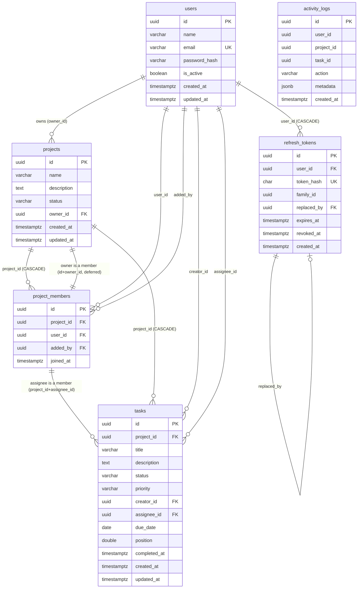

# FinTasks: Database Design

PostgreSQL 16. All schema changes go through Alembic. Conventions: UUID primary keys (`gen_random_uuid()` server default, `uuid4` in Python), `timestamptz` timestamps (UTC), `varchar` + named `CHECK` constraints for enumerations, snake_case names, constraint names generated by the naming convention in `app/database/base.py`.

Required extension: `pg_trgm` (created by the initial migration).

## ER diagram

`activity_logs` has no foreign keys on purpose (see "Activity log and deletion").

## Tables

### users
| Column | Type | Constraints |
|---|---|---|
| id | uuid | PK, default `gen_random_uuid()` |
| name | varchar(120) | NOT NULL, CHECK not blank |
| email | varchar(255) | NOT NULL, UNIQUE, CHECK `email = lower(email)` |
| password_hash | varchar(255) | NOT NULL (Argon2 hash, never the password) |
| is_active | boolean | NOT NULL, default true |
| created_at, updated_at | timestamptz | NOT NULL, default `now()` (`updated_at` also set by the ORM on update) |

The unique constraint creates the email index. The lowercase CHECK makes a plain unique constraint case-insensitive: the application lowercases emails and the database refuses anything else.

### projects
| Column | Type | Constraints |
|---|---|---|
| id | uuid | PK |
| name | varchar(120) | NOT NULL, CHECK not blank |
| description | text | NULL |
| status | varchar(20) | NOT NULL, default `active`, CHECK in (`active`, `archived`) |
| owner_id | uuid | NOT NULL, FK users(id) ON DELETE RESTRICT |
| created_at, updated_at | timestamptz | NOT NULL, default `now()` |

Additional constraint `fk_projects_owner_member`: FOREIGN KEY `(id, owner_id)` REFERENCES `project_members(project_id, user_id)`, `DEFERRABLE INITIALLY DEFERRED`. This guarantees at commit time that the project owner is a member: a project cannot be committed without the owner's membership row, and the owner's membership row cannot be removed while the project exists. Because the check is deferred, the application inserts the project and the owner's membership in one transaction in either order. Deleting the project cascades the members and passes the check because the project row disappears in the same transaction.

Indexes: `ix_projects_owner_id (owner_id)`, `ix_projects_status (status)`.

### project_members
| Column | Type | Constraints |
|---|---|---|
| id | uuid | PK |
| project_id | uuid | NOT NULL, FK projects(id) ON DELETE CASCADE |
| user_id | uuid | NOT NULL, FK users(id) ON DELETE CASCADE |
| added_by | uuid | NOT NULL, FK users(id) ON DELETE RESTRICT |
| joined_at | timestamptz | NOT NULL, default `now()` |

Constraints: `uq_project_members_project_user` UNIQUE `(project_id, user_id)` (membership is unique, and this is the key referenced by the assignee and owner foreign keys). Index `ix_project_members_user_id (user_id)` for "projects of a user".

### tasks
| Column | Type | Constraints |
|---|---|---|
| id | uuid | PK |
| project_id | uuid | NOT NULL, FK projects(id) ON DELETE CASCADE |
| title | varchar(200) | NOT NULL, CHECK not blank |
| description | text | NULL |
| status | varchar(20) | NOT NULL, default `todo`, CHECK in (`todo`, `in_progress`, `completed`) |
| priority | varchar(20) | NOT NULL, default `medium`, CHECK in (`low`, `medium`, `high`) |
| creator_id | uuid | NOT NULL, FK users(id) ON DELETE RESTRICT |
| assignee_id | uuid | NULL, FK users(id) ON DELETE RESTRICT |
| due_date | date | NULL |
| position | double precision | NOT NULL, default 0 (board order within a status column) |
| completed_at | timestamptz | NULL |
| created_at, updated_at | timestamptz | NOT NULL, default `now()` |

Constraints:
- `fk_tasks_assignee_member`: FOREIGN KEY `(project_id, assignee_id)` REFERENCES `project_members(project_id, user_id)` (MATCH SIMPLE, so it is not enforced when `assignee_id` is NULL; `ON DELETE NO ACTION`). The database refuses an assignee who is not a member of the task's project, and refuses removal of a member who still has assigned tasks. The service unassigns the member's tasks before removing the membership (FR-PRJ-8).
- `ck_tasks_completed_at_matches_status`: `(status = 'completed') = (completed_at IS NOT NULL)`.
- The completion policy (assignee present, required fields filled) is NOT a database constraint. It is the configurable `task-complete` policy (`authorization-design.md`).

Indexes:
- `ix_tasks_project_status_position (project_id, status, position)`: board columns and status filter (its prefix serves `(project_id, status)`).
- `ix_tasks_project_created_at (project_id, created_at DESC)`: default list order.
- `ix_tasks_project_due_date (project_id, due_date)`: due date sort and overdue filter.
- `ix_tasks_assignee_id (assignee_id)`: "assigned to me".
- `ix_tasks_title_trgm`, `ix_tasks_description_trgm`: GIN `gin_trgm_ops` for `ILIKE` search.

### activity_logs
| Column | Type | Constraints |
|---|---|---|
| id | uuid | PK |
| user_id | uuid | NOT NULL (the user who acted), NO foreign key |
| project_id | uuid | NULL, NO foreign key |
| task_id | uuid | NULL, NO foreign key |
| action | varchar(50) | NOT NULL, CHECK not blank |
| metadata | jsonb | NOT NULL, default `{}` |
| created_at | timestamptz | NOT NULL, default `now()` |

The ORM attribute is named `meta` because `metadata` is reserved by SQLAlchemy's declarative base. The database column is `metadata`. Metadata holds changed field names and values and target IDs (for example `{"member_id": "..."}`), never secrets or password data.

Indexes: `ix_activity_logs_project_created (project_id, created_at DESC)` (project timeline), `ix_activity_logs_user_created (user_id, created_at DESC)` (user feed), `ix_activity_logs_task_created (task_id, created_at DESC)` (task history).

Action catalog: `user.registered`, `auth.login`, `auth.logout`, `auth.refresh_reuse_detected`, `project.created`, `project.updated`, `project.deleted`, `member.added`, `member.removed`, `task.created`, `task.updated`, `task.status_changed`, `task.assigned`, `task.unassigned`, `task.deleted`. Rows with `project_id IS NULL` (auth events) are excluded from project feeds.

### refresh_tokens
| Column | Type | Constraints |
|---|---|---|
| id | uuid | PK |
| user_id | uuid | NOT NULL, FK users(id) ON DELETE CASCADE |
| token_hash | char(64) | NOT NULL, UNIQUE, CHECK `length = 64` (SHA-256 hex digest) |
| family_id | uuid | NOT NULL (all rotations of one login share it) |
| replaced_by | uuid | NULL, FK refresh_tokens(id) ON DELETE SET NULL |
| expires_at | timestamptz | NOT NULL, CHECK `expires_at > created_at` |
| revoked_at | timestamptz | NULL |
| created_at | timestamptz | NOT NULL, default `now()` |

Only the SHA-256 hash of the opaque token is stored. The length CHECK makes it impossible to store a raw token by mistake. Indexes: unique on `token_hash`, `ix_refresh_tokens_user_id (user_id)`, `ix_refresh_tokens_family_id (family_id)`.

## Relationships and delete behavior

| Relationship | On delete |
|---|---|
| users 1..* projects (owner) | RESTRICT (user deletion is unsupported) |
| projects 1..* project_members | CASCADE |
| users 1..* project_members (member) | CASCADE |
| users 1..* project_members (added_by) | RESTRICT |
| projects 1..* tasks | CASCADE |
| users 1..* tasks (creator) | RESTRICT |
| users 0..* tasks (assignee) | RESTRICT |
| project_members 0..* tasks (assignee in the same project) | NO ACTION: member removal is rejected while tasks are assigned |
| projects 1..1 project_members (owner membership) | Deferred NO ACTION: the owner's membership cannot be removed while the project exists |
| users 1..* refresh_tokens | CASCADE |
| refresh_tokens 0..1 refresh_tokens (replaced_by) | SET NULL |
| activity_logs to anything | no foreign keys |

## Activity log and deletion

Deletes are hard deletes (A15). `activity_logs` has no foreign keys, so the audit trail outlives the rows it describes: deleting a task or a project does not delete or null its history, and entries remain consistent with what happened ("task.deleted" can still be read after the task is gone). Consequences: IDs in the log may point to rows that no longer exist, and the application, not the database, ensures that IDs are real when a row is written. Users are never deleted by the application.

## Normalization notes

- 3NF: membership is its own many-to-many table. Ownership is a single foreign key on `projects`. The assignee is a foreign key on `tasks`. No derived counts are stored.
- Statistics are aggregate queries over the indexes above.
- Scalability: composite indexes for the hot queries, keyset pagination can replace offset later without a schema change, trigram indexes for search.

## Key queries (for index validation)

- Projects of a user: join `project_members` on `user_id`.
- Task list: `WHERE project_id = :p [AND status = :s] [AND priority = :pr] [AND assignee_id = :a] [AND (title ILIKE :q OR description ILIKE :q)] ORDER BY ... LIMIT/OFFSET`.
- Overdue: `WHERE project_id IN (user's projects) AND due_date < current_date AND status <> 'completed'`.
- Dashboard counts: grouped counts over tasks of the user's projects.
- Activity: `WHERE project_id = :p ORDER BY created_at DESC LIMIT :n`.

## Migration plan

| Migration | Contents | When |
|---|---|---|
| `initial schema` | `pg_trgm` and all six tables with constraints and indexes | Database schema milestone (M1b) |
| later | Only changes discovered during implementation; each follows `database-design.md` first | As needed |

Each migration applies on an empty database and has a working `downgrade`.

## Ownership and membership rules in the database

| Rule | Mechanism |
|---|---|
| Owner is a member | Deferred composite FK `projects(id, owner_id)` to `project_members` |
| Membership is unique | `uq_project_members_project_user` |
| Assignee is a project member | Composite FK `tasks(project_id, assignee_id)` to `project_members` |
| Invalid status or priority is impossible | Named CHECK constraints |
| Refresh tokens are never stored in plaintext | `token_hash` CHECK length 64, application hashes with SHA-256 |
